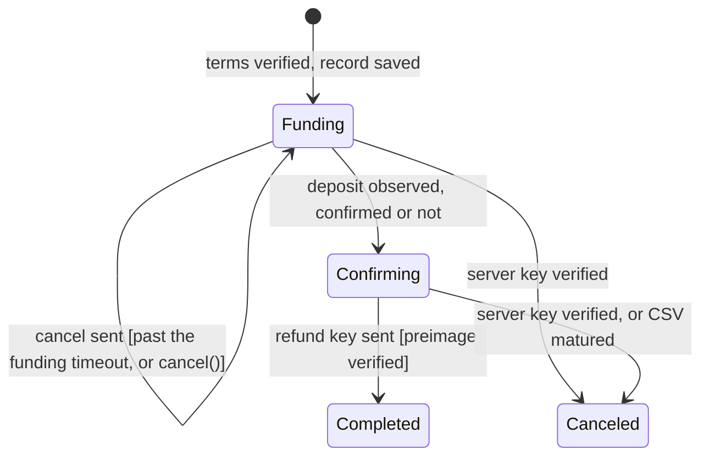
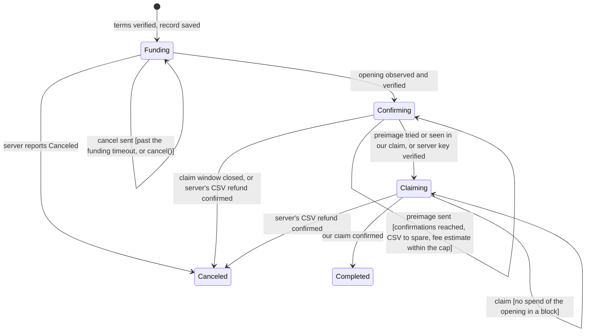

# Running swaps

## Quotes

Every swap starts from a quote: one read of the server's terms for a source,
a destination, and one amount. An end is a chain, or `None` for Lightning.
The amount pins either end: what the user receives, or what they spend.

```rust
let quote = driver.quote(Some(Chain::Bitcoin), None, TargetAmount::Receive(100_000)).await?;
let quote = driver.quote(Some(Chain::Bitcoin), None, TargetAmount::Send(100_000)).await?;
```

`Quote` carries the full price: `send_amount` is `receive_amount` plus
`fee`, split into `base_fee` (the server's on-chain costs at current fee
rates) and `service_fee` (proportional, plus any satoshi rounding leaves).
Pinned by what the user spends, the receive amount is inverted from the send
amount. Both amounts are what the swap is created with. Its `quote_id` pins
the base fee, so the price cannot move between quoting and creating; a quote
older than `expires_at` is refused and you fetch a new one. Show the quote
to the user, create the swap when they accept. The record keeps `base_fee`
and `service_fee` as the server split the swap's own fee.

## SwapIn: on-chain to Lightning

Mint an invoice on your Lightning node for exactly `quote.receive_amount`,
expiring in `quote.await_opening_tx` seconds, and create the swap with it.
Acceptance refuses an invoice whose amount differs or that expires within
`min_confs + 1` blocks. The time to deposit ends `min_confs + 1` blocks
before the invoice expires. The server stops waiting at `await_opening_tx`,
so a longer invoice shows more time than the server keeps.

```rust
let swap = driver.swap_in(quote, bolt11, Some(refund_address)).await?;
println!("deposit {} to {}", swap.record().await?.send_amount, swap.address().await?);
```

The refund address is optional; see [SwapIn funds and refunds](#swapin-funds-and-refunds) for
what happens without one.

The user sends `send_amount` to the address as one output of exactly that
value. From there the driver waits for the invoice to be paid and reveals
the refund key once the preimage is on the table. Anything else that lands
under the script, a wrong amount or a later second deposit, is a stray: it
shows in `funds` and is refunded by the machinery below.

A SwapIn ends in `Completed`, or in `Canceled` when the deposit stays the
user's: the swap was canceled, the server gave up with its key, or the CSV
matured with the deposit unclaimed. Its refund then shows in `funds`.

## SwapOut: Lightning to on-chain

Create the swap with the address the funds should land on, or `None` to
take one from the destinations hook:

```rust
let swap = driver.swap_out(quote, Some(claim_address)).await?;
println!("pay {}", swap.claim_invoice().await?);
```

The user pays `claim_invoice`, a hold invoice for `send_amount`. The server
then opens the on-chain output; the driver waits for it to confirm, hands the
server the preimage that releases the payment, once, and claims the output to
`claim_address` on the next pass: through the keypath when the server answered
with its key, through the preimage path when it did not. The claim is rebuilt
at the current fee rate each pass until it confirms, and outbids a spend still
in the mempool: the server's CSV refund at `max_fee_rate`.

A SwapOut ends in `Completed`, or in `Canceled` when it closes with the
payment safe: the hold invoice expires back, or the server's CSV refund took
the opening. A correct server never refunds an opening after it took our
preimage, so the driver does not tell that case apart. The preimage goes out
only while the fee estimate is within `max_fee_rate`, so the claim can pay
it, and while at least `claim_margin` of the CSV is left. While the estimate
is above it, `Confirming` carries it as `fee_rate_spike`, beside the limit as
`max_fee_rate`. A driver away for
that whole window keeps it and ends the swap once it is back, and the payment
fails back once the server's CSV refund takes the opening.

## Statuses

`swap.status()` reads the store, where every pass resolves it from the chain:

| Status       | Flow    | Meaning                                                                 |
|--------------|---------|-------------------------------------------------------------------------|
| `Restoring`  | both    | Restored, before its first pass: where it stands is not known yet. |
| `Funding`    | both    | Nothing on chain yet. Past `expires_at` the driver sends a cancel and keeps watching. `expires_at` is the time to pay by. SwapIn: `min_confs + 1` blocks before the invoice expires. SwapOut: no later than the expiry of `claim_invoice`. |
| `Confirming` | both    | The opening has `confs` of `needed` confirmations. SwapOut: past `needed`, the preimage waits for the fee estimate to come within `max_fee_rate`, and `fee_rate_spike` is that estimate meanwhile. |
| `Claiming`   | SwapOut | The preimage may have left: claiming the opening, with our `claim`, its `confs` and its `fee` once broadcast. |
| `Completed`  | both    | Paid out; `opening` and `payout` are the txids. SwapOut: `fee` is what our claim paid, read from the confirmed transaction. |
| `Canceled`   | both    | The swap did not happen, for `reason`. SwapOut: the payment is safe, and `opening` is set when it is left to the server's CSV refund. SwapIn: the deposit is the user's, in `funds`. |

`fee` is the network fee of our own spend: a SwapOut claim here, a SwapIn
refund on its funds. It is paid from the coins spent, not `base_fee`, so a
SwapOut lands `receive_amount` minus its claim fee. It is `None` only with no
spend of ours to read:

| `fee` is `None`                  | Why                                       |
|----------------------------------|-------------------------------------------|
| SwapOut `Claiming` with no `claim` | not claimed yet                         |
| SwapIn `Completed`               | the payout is the server's                |
| a swap finished before 1.4.0     | not read since; `swap.step()` reads it    |

A `Canceled` status says why in `reason`:

| Reason              | Flow    | Meaning                                                                  |
|---------------------|---------|--------------------------------------------------------------------------|
| `ServerCanceled`    | both    | The server gave the swap up, with its `error_type` and `cancel_message`. `UserCanceled` is any cancel the driver sent; `cancel_message` says whose. |
| `CsvMatured`        | SwapIn  | The deposit's CSV matured with no word from the server.                  |
| `ServerRefunded`    | SwapOut | The server's CSV refund took the opening.                                |
| `ClaimWindowClosed` | SwapOut | Less than `claim_margin` of the CSV was left before the preimage went out. The payment fails back once the server's CSV refund confirms, from block `at` at the earliest. |

`Completed` and `Canceled` are terminal (`status.is_terminal()`). A
terminal SwapOut goes quiet at once. A terminal SwapIn keeps getting passes
while a refund of ours is unconfirmed, while anything is `Locked` or
`Refundable` and there is somewhere to refund it, and for `refund_timeout`
after it ended, so a deposit that crossed the end is found. A quiet SwapIn
holding `Dust` gets a pass again once the chain's fee rate makes it worth
its refund.

The record's `server_status` is the server's own label from the last pass.
Show it so a swap waiting on the server says whom it waits for; the driver
never acts on it.

The transitions, one diagram per flow. An edge is what one pass did, and in
brackets what it observed to do it. The funding timeout is 20 minutes, the
default.

SwapIn. The user deposits and the server pays the invoice; every deposit ends
either claimed against a preimage the driver verified, or the user's to take
back.



SwapOut. The user pays a hold invoice and the server locks the payout on
chain; nothing is at stake until the preimage leaves, and after that only a
confirmed claim recovers the money.



## Canceling

```rust
match swap.cancel().await? {
    Cancellation::Requested => {} // canceled, or closes once the server confirms
    Cancellation::TooLate => {}   // the payment already left; the swap continues
}
```

A swap can only be canceled while nothing irreversible has happened: before
a SwapIn deposit is claimed and before a SwapOut tries its preimage. A cancel
repeated on a canceled swap answers `Requested` again, so a call whose answer
was lost can be retried.

## SwapIn funds and refunds

`swap.funds()` lists every output under the script that is the user's, as
the last pass left it: every stray, and the deposit once the swap is
canceled. The deposit the server was paid for is not listed, nor is an
output the server took by its own path.

| `FundState`  | Meaning                                                              |
|--------------|----------------------------------------------------------------------|
| `Locked`     | Under the CSV until `at`, or unconfirmed                             |
| `Refundable` | Spendable now and worth its fee: the next refund takes it            |
| `Dust`       | Spendable, but worth less than its fee at the last rate; `run` refunds it once the rate falls far enough |
| `Refunding`  | In our refund `txid` paying `fee`, not yet in a block                |
| `Refunded`   | In our refund `txid` paying `fee`, in a block                        |

A refund's `fee` is the whole transaction's, so every fund it took shows the
same one. Group by `txid` before adding fees up.

A stray that lands after a SwapIn is `Completed` waits out the CSV: the
refund key went to the server, so it shows `Locked` until block `at` and then
refunds by the CSV path. Until then the server holds the preimage and both
keys and can take it first. `run` only finds it within `refund_timeout` of the
end; after that, `swap.step()` does.

A rescan of a finished swap is `step`, then `funds`:

```rust
if let Some(swap) = driver.get(swap_id).await? {
    swap.step().await?;
    let funds = swap.funds().await?;
}
```

| What | How `step` treats a finished swap |
|---|---|
| Reads | What any pass reads: the server's status, the address history with the mempool, and the spends of what it holds, also for a swap `run` no longer passes |
| Updates | The status, `funds` and the rest of the record, saved and yielded to `subscribe` when they change. A late deposit is a new fund; the status stays as it was |
| Afterwards | A found deposit keeps the swap in `run` until its refund is in a block, when the swap has a refund address or `with_destinations` is set. Without either it waits for `swap.refund(destination)` |
| Beside `run` | Safe: `step` takes the swap's lock, as `run`'s pass does, and works on the record that pass saved |
| Failure | Returns the `DriverError`, `Chain` for an Esplora outage, whose `retryable()` is true; calling again retries |

It finds only what is already sent: a deposit sent after it needs another
`step`.

Every pass refunds what is `Refundable` in one transaction, keypath when it
holds the server's key and CSV otherwise, in any status, unless a refund of
ours is still `Refunding`. A transaction takes at most 8 funds, the most
valuable first; the rest stay `Refundable`, with no queued state, and go on
the first pass after it is in a block. Its
fee rate is the estimate, capped at `max_fee_rate`: a refund never waits for
the rate to fall, as a SwapOut's preimage does. A
swap can see several refunds, each fund carrying the txid of the one that took
it. It pays the refund address given to
`swap_in`, which travels in the signed request. A swap created without one
falls back to a `Destinations`, asked once per broadcast:

```rust
#[async_trait]
impl Destinations for MyWallet {
    async fn claim_address(&self, chain: Chain) -> Result<String, String> {
        self.next_address(chain).await.map_err(|e| e.to_string())
    }
    async fn refund_address(&self, chain: Chain) -> Result<String, String> {
        self.claim_address(chain).await
    }
}

let driver = driver.with_destinations(my_wallet);
```

Registered like this, `run` refunds anything refundable the moment it can,
and `swap_out` may pass `None` for its claim address. An `Err` fails the call
that asked, as `DriverError::Destination`. The hook must resolve promptly:
the loop ticks swaps one at a time and waits on it, so bound any remote call
with a timeout and do not wait on the user there. Without a hook, call
`swap.refund(&destination).await?` on a `SwapIn` handle yourself, in any
status; it makes one pass, refunds to `destination` and returns the refund's
txid, or `None` while nothing is refundable.

## Configuration

`Config` (via `with_config`) holds the flow-independent knobs:

| Knob              | Default | Meaning                                                        |
|-------------------|---------|----------------------------------------------------------------|
| `funding_timeout` | 24 h    | From creation: the latest a swap with nothing on chain cancels; the invoice's expiry or the server's cancel ends it sooner |
| `poll_interval`   | 15 s    | The longest wait between passes without a server signal        |
| `server_timeout`  | 30 s    | How long a call to the server may go unanswered before it fails as a transport error |
| `fee_conf_target` | 3 blocks| The target every fee estimate is read at                       |
| `fee_rate_cache_ttl` | 30 s | How long a chain's fee estimate is reused before it is read again; zero reads it every pass |
| `refund_timeout`  | 1 h     | From a SwapIn's end: how long it keeps getting passes once nothing of the user's is left to move |
| `max_htlc_hold`   | 1008 blocks | The longest a SwapOut's hold invoice may hold the payment, in Lightning blocks |

`ChainConfig` (passed with each `with_chain`) holds the per-chain ones, with
`ChainConfig::bitcoin()` and `ChainConfig::liquid()` as defaults:

| Knob             | Bitcoin | Liquid | Meaning                                             |
|------------------|---------|--------|-----------------------------------------------------|
| `min_confs`      | 3       | 2      | Depth that releases a SwapOut claim, and closes a swap on a spend |
| `claim_margin`   | 252     | 2520   | How much CSV must remain when the preimage goes out |
| `max_refund_csv` | 1008    | 10080  | The longest CSV accepted on a SwapIn deposit        |
| `max_fee_rate`   | 100     | 1      | The rate no spend goes above, in sat/vB, finite and positive; a SwapOut holds its preimage while the estimate is above it, and a SwapIn refund pays it |
| `block_time`     | 600 s   | 60 s   | Expected block interval, for mixed deadline math    |
