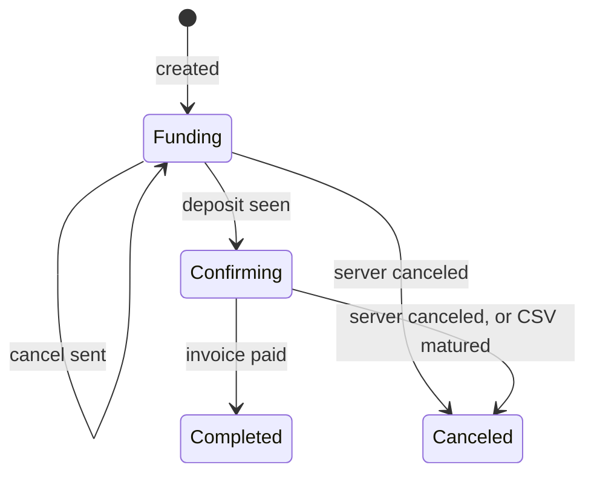
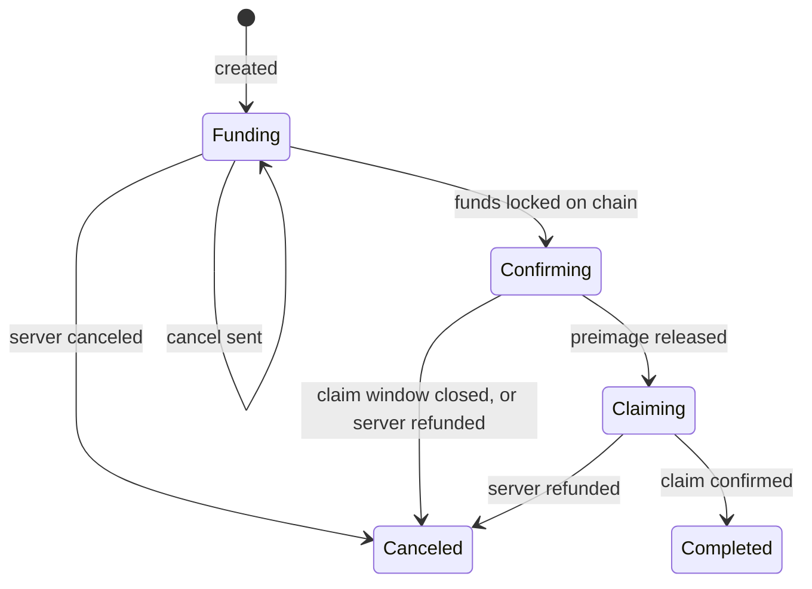

# Swaps

## Quotes

A quote is the server's price for one swap: a source, a destination and one
amount. An end is a chain, or Lightning. The amount fixes either end, what the
user receives or what they send.

<Code>
<Rust>

```rust
let target = TargetAmount::Receive(100_000); // or TargetAmount::Send(100_000)
let quote = driver.quote(Some(Chain::Bitcoin), None, target).await?;
```

</Rust>
<Ts>

```ts
const target = { receive: 100_000n }; // or { send: 100_000n }
const quote = await driver.quote({ chain: Chain.Bitcoin }, "lightning", target);
```

</Ts>
</Code>

| Field              | Meaning                                                                                     |
| ------------------ | ------------------------------------------------------------------------------------------- |
| `receive_amount`   | what the user receives                                                                      |
| `send_amount`      | what the user pays: `receive_amount` plus `fee`                                             |
| `fee`              | `base_fee` plus `service_fee`                                                               |
| `base_fee`         | the server's on-chain costs at the current fee rate                                         |
| `service_fee`      | the proportional fee, plus any rounding                                                     |
| `expires_at`       | the last moment a swap can be created from it; after it, creating fails with `QuoteExpired` |
| `await_opening_tx` | SwapIn: how long the server waits for the deposit, in seconds                               |

Show the quote, and create the swap when the user accepts. The swap carries
both amounts as quoted. A SwapOut's claim pays its own network fee out of
`receive_amount`.

## SwapIn

Mint an invoice for the quote and create the swap with it:

<Code>
<Rust>

```rust
let swap = driver.swap_in(quote, bolt11, Some(refund_address)).await?;
let record = swap.record().await?;
println!("deposit {} to {}", record.send_amount, swap.address().await?);
```

</Rust>
<Ts>

```ts
const swap = await driver.swapIn(quote, bolt11, refundAddress);
const { send_amount } = await swap.record();
console.log(`deposit ${send_amount} to ${await swap.address()}`);
```

</Ts>
</Code>

| Requirement                                                           | Otherwise                                                           |
| --------------------------------------------------------------------- | ------------------------------------------------------------------- |
| The invoice is for exactly `receive_amount`                           | creating the swap fails                                             |
| The invoice outlives <Id rust="min_confs" ts="minConfs" /> + 1 blocks | creating the swap fails                                             |
| The invoice expires in `await_opening_tx` seconds                     | a longer one shows the user more time than the server waits         |
| The user sends `send_amount` to the address as one output             | the output is a stray, refunded as [Refunds](refunds.mdx) describes |

The refund address is optional: without one, a refund waits for an address
from [the destinations hook or a call](refunds.mdx#where-refunds-go).

A SwapIn ends `Completed` once the server paid the invoice, or `Canceled`
with the deposit still the user's, in [`funds`](refunds.mdx).

## SwapOut

Create the swap with the address the funds land on, or none to take one from
the [destinations hook](refunds.mdx#where-refunds-go):

<Code>
<Rust>

```rust
let swap = driver.swap_out(quote, Some(claim_address)).await?;
println!("pay {}", swap.claim_invoice().await?);
```

</Rust>
<Ts>

```ts
const swap = await driver.swapOut(quote, claimAddress);
console.log(`pay ${await swap.claimInvoice()}`);
```

</Ts>
</Code>

The user pays <Id rust="claim_invoice" ts="claimInvoice()" />, a hold invoice
for `send_amount`. The payment stays pending while the server locks the funds
on chain. Once they are deep enough, the driver releases the preimage, which
lets the payment settle, and claims the funds to the claim address.

| The preimage waits while                                                      | Status                                              |
| ----------------------------------------------------------------------------- | --------------------------------------------------- |
| the funds have fewer than <Id rust="min_confs" ts="minConfs" /> confirmations | `Confirming`, with `confs` of `needed`              |
| the fee estimate is above <Id rust="max_fee_rate" ts="maxFeeRate" />          | `Confirming`, with the estimate as `fee_rate_spike` |

Once less than <Id rust="claim_margin" ts="claimMargin" /> of the CSV is left,
the preimage never goes out: the swap ends `Canceled` with
`ClaimWindowClosed`, and the payment fails back.

A SwapOut ends `Completed` once the claim confirms, or `Canceled` with the
payment failed back or failing back.

## Statuses

`swap.status()` returns where the swap stands:

| Status       | Flow    | The swap                                  | Fields                                                                                                     |
| ------------ | ------- | ----------------------------------------- | ---------------------------------------------------------------------------------------------------------- |
| `Restoring`  | both    | was restored and is not read yet          |                                                                                                            |
| `Funding`    | both    | has nothing on chain yet                  | `expires_at`, the time to pay by; `cancel_sent` once the driver asked the server to cancel                 |
| `Confirming` | both    | is on chain, confirming                   | `txid`, `confs` of `needed`; SwapOut: `fee_rate_spike` while fees hold the preimage, beside `max_fee_rate` |
| `Claiming`   | SwapOut | has released its preimage and is claiming | `opening`; `claim`, `confs` and `fee` once the claim is broadcast                                          |
| `Completed`  | both    | is paid out                               | `opening`, `payout`; SwapOut: `fee`, what the claim paid                                                   |
| `Canceled`   | both    | did not happen, for `reason`              | `opening`, when the server's CSV refund takes it                                                           |

`expires_at` is <Id rust="min_confs" ts="minConfs" /> + 1 blocks before the
invoice expires on a SwapIn, and no later than the hold invoice's expiry on a
SwapOut. Past it, the driver asks the server to cancel and keeps watching.

`fee` is the network fee of the user's own claim, read from the chain. It is
<Id rust="None" ts="null" /> until a claim is broadcast, and on a SwapIn,
whose payout is the server's.

A `Canceled` swap says why in `reason`:

| Reason              | Flow    | Meaning                                                                                                                                             |
| ------------------- | ------- | --------------------------------------------------------------------------------------------------------------------------------------------------- |
| `ServerCanceled`    | both    | The server gave the swap up, with its `error_type` and `cancel_message`. `UserCanceled` is any cancel the driver sent; `cancel_message` says whose. |
| `CsvMatured`        | SwapIn  | The deposit's CSV matured with no word from the server.                                                                                             |
| `ServerRefunded`    | SwapOut | The server's CSV refund took the funds.                                                                                                             |
| `ClaimWindowClosed` | SwapOut | The CSV ran short before the preimage went out. The payment fails back once the server's CSV refund confirms, from block `at` at the earliest.      |

`Completed` and `Canceled` are terminal: the deal is settled. A SwapIn's
[`funds`](refunds.mdx) can still move after it.

The record's `server_status` is the server's own label from the last time the
driver reached it. Show it, so a swap waiting on the server says so. It is not
a sign the server is up, and the driver never acts on it.

### SwapIn



### SwapOut



## Canceling

<Code>
<Rust>

```rust
match swap.cancel().await? {
    Cancellation::Requested => {}
    Cancellation::TooLate => {}
}
```

</Rust>
<Ts>

```ts
const answer = await swap.cancel(); // "Requested" or "TooLate"
```

</Ts>
</Code>

| Answer      | Meaning                                                                                                         |
| ----------- | --------------------------------------------------------------------------------------------------------------- |
| `Requested` | The swap is canceled, or closes once the server confirms. Asking again answers `Requested` again.               |
| `TooLate`   | The payment already left: a SwapIn's deposit was claimed, or a SwapOut's preimage went out. The swap continues. |
